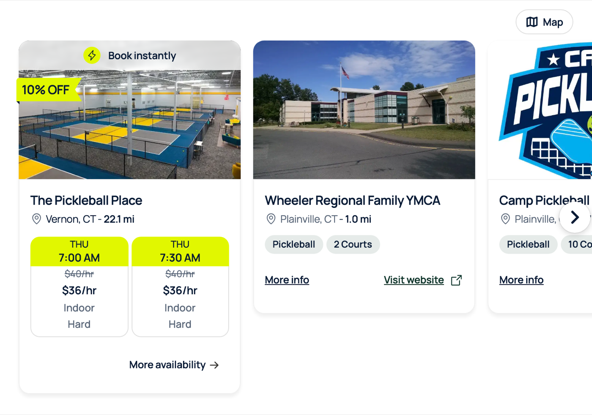
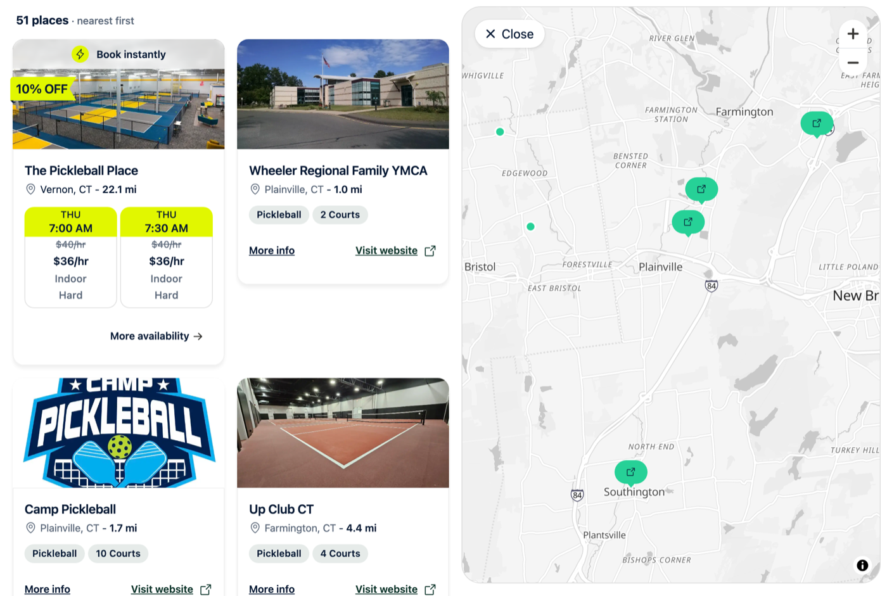
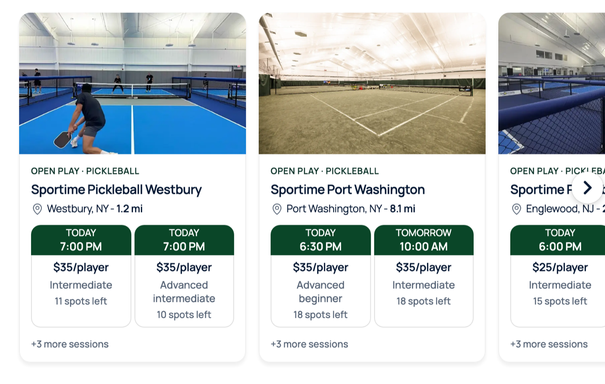
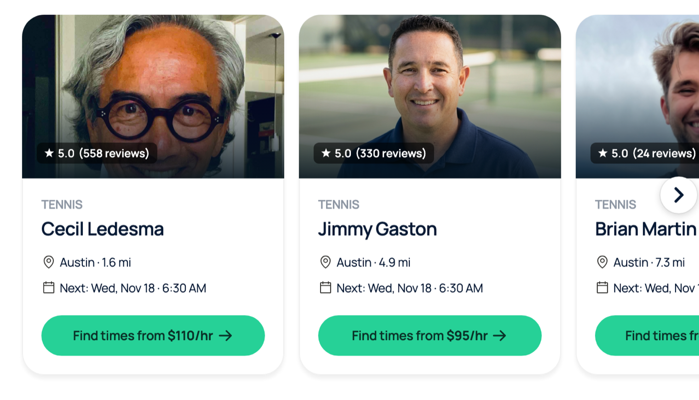
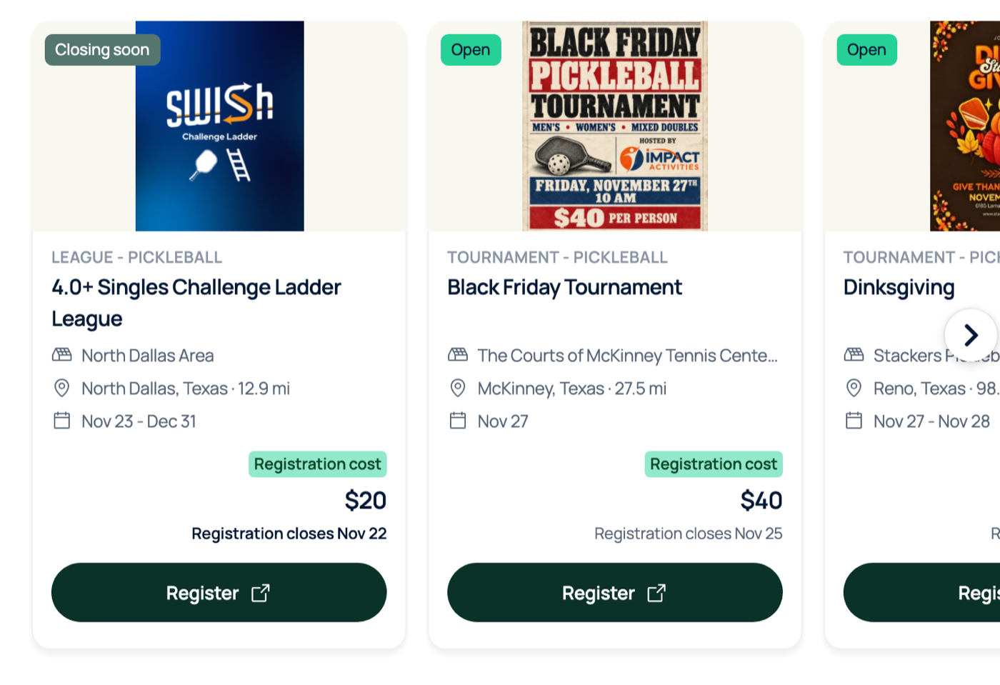

<p align="center">
  
</p>

<h1 align="center">CourtsApp MCP</h1>

<p align="center">
  Find pickleball, tennis and padel courts, open play, coaches and tournaments, and book on CourtsApp.
</p>

<p align="center">
  <a href="https://courtsapp.com">Website</a> ·
  <a href="https://claude.ai/directory/courtsapp">Claude</a> ·
  <a href="https://chatgpt.com/plugins/plugin_asdk_app_69c2eac29cb48191bc7130dc309935c3">ChatGPT</a> ·
  <a href="https://courtsapp.com/privacy-policy">Privacy</a>
</p>

---

CourtsApp is the official hosted MCP server from [CourtsApp](https://courtsapp.com). Ask your AI assistant for a court near any US city and get open times, prices and a link to book.

- **Server URL:** `https://api.courtsapp.com/mcp`
- **Transport:** Streamable HTTP
- **Auth:** none. No account, API key or sign-in is needed to search.
- **Cost:** free to use.

This repo holds docs only. The server is hosted by CourtsApp, so there is nothing to install or run.

## What you can ask

```text
Find a pickleball court near Plainville, CT tomorrow around 6pm.
What tennis courts are open near 10010 this Saturday morning?
Is there open play near Westbury, NY tonight?
Find me a tennis coach in Phoenix for weekend evenings.
Any pickleball tournaments near Dallas next month?
```

## Screenshots

**Court search with live open times**



**Map view**



**Open play**



**Coaches**



**Tournaments**



## Connect

### Claude

CourtsApp is in the [Claude connector directory](https://claude.ai/directory/courtsapp). Open it and click **Connect**.

### ChatGPT

Open the [CourtsApp app in ChatGPT](https://chatgpt.com/plugins/plugin_asdk_app_69c2eac29cb48191bc7130dc309935c3) and add it. Then mention `@CourtsApp` in a chat.

### Claude Code

```bash
claude mcp add --transport http courtsapp https://api.courtsapp.com/mcp
```

### Cursor

Add this to `~/.cursor/mcp.json`:

```json
{
  "mcpServers": {
    "courtsapp": {
      "url": "https://api.courtsapp.com/mcp"
    }
  }
}
```

### VS Code

Add this to `.vscode/mcp.json`:

```json
{
  "servers": {
    "courtsapp": {
      "type": "http",
      "url": "https://api.courtsapp.com/mcp"
    }
  }
}
```

### Cline

Open **MCP Servers → Configure**, or edit `cline_mcp_settings.json` (Cline CLI: `~/.cline/data/settings/cline_mcp_settings.json`), and add:

```json
{
  "mcpServers": {
    "courtsapp": {
      "type": "streamableHttp",
      "url": "https://api.courtsapp.com/mcp",
      "disabled": false,
      "autoApprove": []
    }
  }
}
```

Keep any servers already in the file. Cline loads the file when a new task starts.

### Grok Build

Use the [CourtsApp Grok plugin](https://github.com/courtsapp/courtsapp-grok-plugin).

### Any other MCP client

Add a remote (Streamable HTTP) server with the URL `https://api.courtsapp.com/mcp`. No headers or keys are needed.

## Tools

| Tool | What it does |
| --- | --- |
| `search_courts` | Finds places to play near a city, zip code or map point. With a sport, it returns live open court times and prices at nearby clubs. |
| `get_facility_times` | Lists every open court time at one club on one day, with prices and a booking link. |
| `get_facility_details` | Hours, address, phone, amenities, policies, sports and courts for one club. |
| `get_booking_link` | Returns a link that opens checkout on CourtsApp for a chosen court and time. |
| `search_open_play` | Finds open play (drop-in) sessions with spots left. |
| `search_lessons` | Finds coaches for private pickleball or tennis lessons. |
| `get_lesson_times` | Shows when a coach is free for a lesson. |
| `get_coach_profile` | A coach's bio, locations, lesson lengths and cancellation policy. |
| `get_lesson_booking_link` | Optional. Prepares a lesson checkout on TeachMe.To with the student's details filled in. |
| `search_tournaments` | Finds tournaments and leagues near a location or by name. |
| `record_click` | Counts link clicks on CourtsApp cards for CourtsApp's own stats. |

Sports: pickleball, tennis, padel, badminton, racquetball, squash and table tennis. Lessons cover pickleball and tennis.

In Claude and ChatGPT, results show as interactive cards with a map, club profiles and booking buttons. Other clients get the same data as text.

## Data and privacy

- Every tool except `get_lesson_booking_link` and `record_click` is read-only.
- Searching needs no personal details.
- `get_lesson_booking_link` runs only when the user asks to have their details filled in. It sends the student's name, email and phone to TeachMe.To to prepare the checkout. Nothing is charged until the user pays on TeachMe.To.
- `record_click` keeps the kind of link, the club, the destination and which assistant showed the card. It keeps nothing about the person.
- Court bookings are paid on CourtsApp's own checkout page, never inside the chat.

Full policy: [courtsapp.com/privacy-policy](https://courtsapp.com/privacy-policy)

## Listings

- [Claude directory](https://claude.ai/directory/courtsapp)
- [ChatGPT apps](https://chatgpt.com/plugins/plugin_asdk_app_69c2eac29cb48191bc7130dc309935c3)
- [Official MCP Registry](https://registry.modelcontextprotocol.io/v0/servers?search=com.courtsapp/mcp): `com.courtsapp/mcp`
- [Glama](https://glama.ai/mcp/connectors/com.courtsapp/mcp)
- [MCP Market](https://mcpmarket.com/server/courtsapp)
- [mcp.so](https://mcp.so/server/courtsapp)
- [mcpservers.org](https://mcpservers.org/servers/courtsapp-com)

## Support

Questions or problems: open an issue here or email cooper@courtsapp.com.
